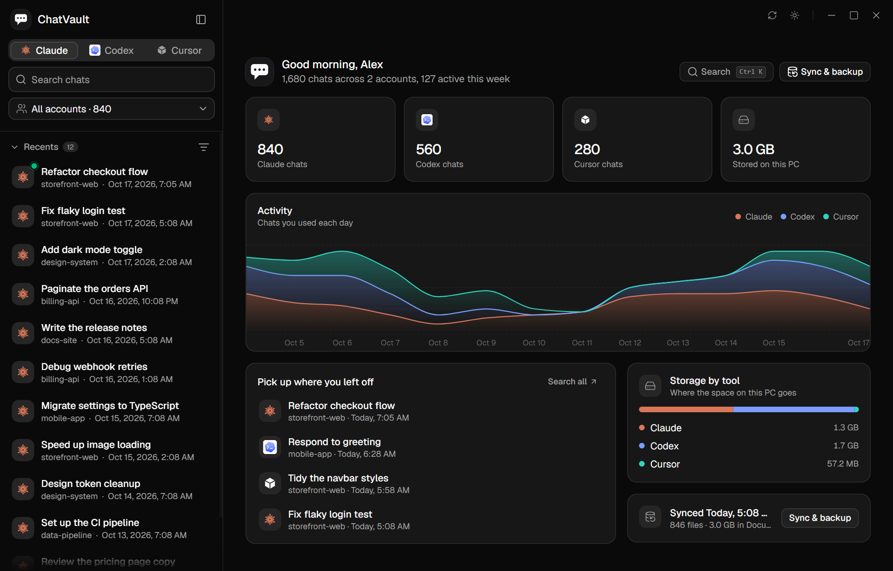
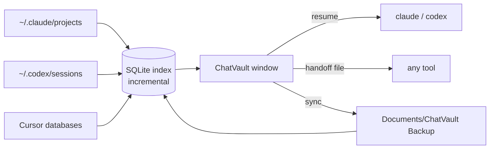

<div align="center">


# ChatVault

**One place to read, search, back up and continue every AI coding chat on your PC.**

Claude Code · Codex · Cursor — across every account you have ever signed in with.

[](https://github.com/ssanaullahrais/Chat-Vault/releases/latest)
[](https://github.com/ssanaullahrais/Chat-Vault/releases)
[](#download)
[](https://tauri.app)
[](LICENSE)

[Download](#download) · [Features](#features) · [How it works](#how-it-works) · [Privacy](#privacy) · [Build from source](#build-from-source)

</div>

<p align="center">
  
</p>
<p align="center"><sub>All screenshots use sample data, not real chats.</sub></p>

---

## Why ChatVault?

Claude, Codex and Cursor keep your chats on your computer, but each app only shows the chats of the account that is signed in right now. Sign out, switch accounts or reinstall, and your history seems to vanish, even though the files are still on disk.

ChatVault finds those files, lists them in one fast window, and lets you read them, search them, back them up and **pick the work up again in another tool without losing the context**.

## Download

Get the latest installer from the **[Releases page](https://github.com/ssanaullahrais/Chat-Vault/releases/latest)**.

| File | Use it when |
| --- | --- |
| `ChatVault_x.y.z_x64-setup.exe` | You want the normal installer (recommended) |
| `ChatVault_x.y.z_x64_en-US.msi` | You deploy with Windows Installer or Group Policy |
| `ChatVault_x.y.z_x64-portable.exe` | You want to run it without installing |

Requires Windows 10 or 11 (64-bit). The installers are small (about 3 to 4 MB) and use the WebView2 runtime that ships with Windows.

> **Updates are automatic.** ChatVault checks GitHub for a newer release, downloads it in the background and shows a toast with a **Restart now** button.

## Features

### Read everything in one place

- **Claude Code, Codex and Cursor** in a single list, with a tab for each tool.
- **Every account at once.** The account dropdown filters by account and shows the email when it is known.
- **Built for huge histories.** Chats come from a local SQLite index and load 20 at a time as you scroll. Re-scanning only reads files that changed.
- **Pinned and Recents**, sort and filter menus, grouping by project, and your own chat names. All of it is remembered between launches.
- **Search** (`Ctrl+K`) finds chats and actions, and the sidebar search looks inside every message.

### A chat view that stays fast and is easy to read

- **A chat opens on its latest messages.** Only the messages on screen are drawn (virtualized), so even a chat with thousands of messages scrolls smoothly. Earlier messages load as you scroll up to them, or with **Load earlier messages**.
- Markdown, tables, task lists and **code blocks with syntax highlighting**, a copy button and horizontal scrolling for long lines.
- Tool use is collapsed into tidy **steps**: terminal commands with their output, plans and to-do lists, sub-agent runs, web sources, reasoning and error stack traces.
- Links become **inline citations** with a hover preview.
- **Find in chat** (`Ctrl+F`) with highlighted matches and next or previous buttons.

### Jump anywhere with the timeline

A **conversation timeline** beside the chat shows every question you asked, even in messages that are not loaded yet. It swells like a wave under your pointer, previews the question you are about to jump to, and takes you straight there when you click.

### Live, as the agent works

- The open chat **updates in real time**: new messages appear at the bottom while you scroll up or down, and you stay where you are.
- A **green dot** on the chat in the sidebar and in its header, plus a "working" indicator at the end of the conversation, show when an agent is writing to it.
- New conversations from Claude Code, Codex and Cursor **appear in the list on their own**.

### Pictures in chats

Pictures you pasted into a chat show up in the conversation with **hover actions** (full screen, copy, download). The full-screen viewer slides between every picture in the chat with the arrow keys.

### Continue and fork the work

- **Continue in Claude Code** (`claude --resume`) or **in Codex** (`codex resume`) with one click. It works for chats from other accounts too, because the transcript is read straight from disk.
- **Continue in the other tool.** A Claude chat can continue in Codex and the other way round. ChatVault writes a *handoff file* with the whole conversation and starts the other tool with a prompt to read it, so no context is lost.
- **Fork chat** makes a copy of the chat next to the original and opens it right away, with no terminal. The original is never touched.
- Open the project folder, copy ready-made PowerShell commands, show the transcript file, or save a chat as Markdown. Every chat in the sidebar has the same menu.

### Filters and sorting

Organize the sidebar by project or by date, sort by recent, oldest, title or size, and choose what each row shows.

### Never lose a chat

- **Sync & backup** copies Claude and Codex chats to `Documents\ChatVault Backup`. ChatVault also reads that folder, so your chats stay visible after you sign out or reinstall.
- **Restore missing** copies back only the chats that are gone, so Claude and Codex can list them again. It never overwrites or deletes anything.
- **Delete with confirmation** moves a chat to the Recycle Bin, so it can still be restored.

### An overview that tells you something

Chats per tool, activity for the last 14 days, space used on disk, backup status and a quick way back into your latest chats.

### Made for Windows

A custom title bar with your own window controls, a start screen, light and dark themes, and an installer of about 3 to 4 MB that uses the WebView2 runtime already on Windows.

## Supported tools

| Tool | Reads | Continue | Notes |
| --- | --- | --- | --- |
| **Claude Code** | Terminal and desktop-app chats | Resume, fork, handoff to Codex | Titles and accounts come from the Claude desktop app's session files |
| **Codex** | Current and compressed (`.jsonl.zst`) chats | Resume, fork, handoff to Claude | Thread names come from `session_index.jsonl` |
| **Cursor** | IDE chats and Cursor CLI chats, including conversations Cursor has only just written | Handoff to Claude or Codex | Some Cursor agent chats are encrypted by Cursor and cannot be read from outside it |

## How it works



1. **Scan.** A Rust scanner reads the places each tool stores chats. Only new or changed files are parsed again.
2. **Index.** Titles, projects, accounts and times go into a local SQLite database with full-text search.
3. **Read on demand.** A chat is parsed only when you open it, newest messages first, and the page stays in sync with the file while an agent is writing to it.

## Privacy

ChatVault is a local app. It only **reads** your chat files, never uploads them and needs no account. The only network request it makes is to GitHub, to check for a new version. It never touches your sign-in files.

## Keyboard shortcuts

| Keys | Action |
| --- | --- |
| `Ctrl` + `K` | Search chats and actions |
| `Ctrl` + `F` | Find in the open chat |
| `Enter` / `Shift` + `Enter` | Next or previous match |
| `Esc` | Close search |

## Build from source

You need Node 20 or newer, Rust, and the [Tauri prerequisites for Windows](https://tauri.app/start/prerequisites/) (WebView2 and the Visual Studio C++ build tools).

```bash
git clone https://github.com/ssanaullahrais/Chat-Vault.git
cd Chat-Vault
npm install
npm run tauri dev      # run with hot reload
npm run tauri build    # build the installers
```

The installers appear in `src-tauri/target/release/bundle/`. To produce the signed update files, set `TAURI_SIGNING_PRIVATE_KEY` first.

## Releasing

Update the version in `package.json`, `src-tauri/Cargo.toml` and `src-tauri/tauri.conf.json`, then push a matching tag:

```bash
git tag v0.3.0
git push origin v0.3.0
```

The [release workflow](.github/workflows/release.yml) builds the `.msi`, the setup `.exe` and a portable `.exe`, signs the update bundles and publishes everything, including the `latest.json` that installed copies use to update themselves.

## Tech stack

[Tauri 2](https://tauri.app) · Rust · SQLite (FTS5) · React 19 · TypeScript · Tailwind CSS 4 · [shadcn/ui](https://ui.shadcn.com)

## License

[MIT](LICENSE) © Sanaullah Rais

<div align="center">
<sub>ChatVault is an independent project and is not affiliated with Anthropic, OpenAI or Anysphere.</sub>
</div>
